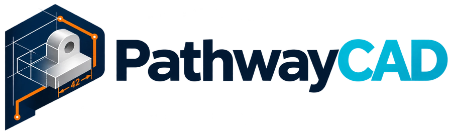

# Pathway CAD

A 3D part modeler for students, in the style of professional parametric CAD tools: sketch, extrude, add details, then export for 3D printing. Open `index.html` from a web server (the GitHub Pages site works), or run the Windows app. It works offline once loaded, with no accounts.

- **Sketch** on the floor, front or side plane, or on any flat face of the part. Tools: line, rectangle, circle, 3-point arc, polygon, slot, construction lines. Clicks snap to the grid and to the ends and centers of other shapes.
- **Sizes you can click:** every sketch shape shows its size. Click a number to type a new one, a parameter name, or a formula like `width/2`.
- **Closed-shape check:** closed areas are shaded. Red dots mark line ends that do not meet anything.
- **Features:** Extrude (add, cut, intersect, through all, both ways, taper), Revolve, Hole (plain, counterbore, countersink), Box, Cylinder, Sphere, Fillet, Chamfer, Shell, Rectangular and Circular pattern, Mirror, Mirror Part.
- **Model tree:** the part's recipe. Double-click a step to change it and the part rebuilds. Right-click to rename, suppress, roll back, move or delete. Problems show as a red ✕ with a plain-English reason.
- **Follows changes:** sketches drawn on a face, holes, picked fillet edges and shell faces follow the face or edge when earlier sizes change.
- **Parameters:** named sizes (`len = 60`) used anywhere a number goes.
- **Inspect:** measure distances and round-edge diameters; Part Info shows size, volume, surface area and mass in 11 materials.
- **Files:** Save/Open `.pcad` part files; export STL (3D printing) and STEP (other CAD programs); save a picture. Work is also kept automatically on the computer.
- **Sketch rules (constraints):** coincident, horizontal, vertical, parallel, perpendicular, equal, tangent, concentric, midpoint and fix, plus line lengths and arc radii that drive the shape. Auto rules are added while drawing; a solver keeps them true when sizes or parameters change, and refuses rules that fight each other.
- **Assemblies (.pasm):** place parts (from files, examples, copies or new parts made in place), then hold them together with Mate, Flush, Insert, Axis and Angle constraints. Drag parts to see how they can still move, ground parts, edit a part in place, check interference (overlaps shown in red), and get a parts list with mass (also as CSV). Assembly files keep their parts inside them.
- **Drawings:** printable 2D sheets (A4, A3, Letter, Tabloid) with front, top, right and isometric views, hidden lines, overall sizes, hole callouts, sizes and notes you add, a title block, third or first angle layout, and a parts list for assemblies. Print to PDF at real scale or save SVG.
- **Units:** millimetres or inches per part or assembly, with conversion. STL and STEP exports are always in millimetres.
- **Examples:** a mounting bracket, wheel hub, key tag and pencil cup, plus two assemblies (bracket and pin, wheels on an axle).

Mouse: right-drag turns, middle-drag (or Shift + right-drag) slides, the wheel zooms toward the pointer.

## Files

- `src/` is the source: `app.js` (screens, commands, history), `assembly.js` (assemblies and their solver), `constraints.js` (sketch rules solver), `drawing.js` (drawing sheets), `units.js`, `model.js` (rebuilds the part from its feature list), `sketch.js` (sketch shapes and closed loops), `sketcher.js` (drawing on a plane), `viewport.js` (3D view and picking), `expr.js` (formulas), `examples.js`, `worker.js` (runs the modeling engine in the background).
- `index.html`, `app.js`, `worker.js`, `style.css`, `replicad_single.wasm` and `assets/` (logo and icons) are the built app. Rebuild after changing `src/`:

      npm install
      npm run build

## Windows app

`desktop/` wraps the app in its own window (Electron). The exe is a single portable file, no installer:

    cd desktop
    npm install
    npm run build        # writes desktop/dist/PathwayCAD.exe

The **Pathway CAD exe** GitHub Action builds it too; download it from the run page.

## Credits

Solid modeling by [OpenCascade](https://dev.opencascade.org/) through [replicad](https://replicad.xyz/) (LGPL-2.1 and MIT), 3D view by [three.js](https://threejs.org/) (MIT). License texts are in `licenses/`.
